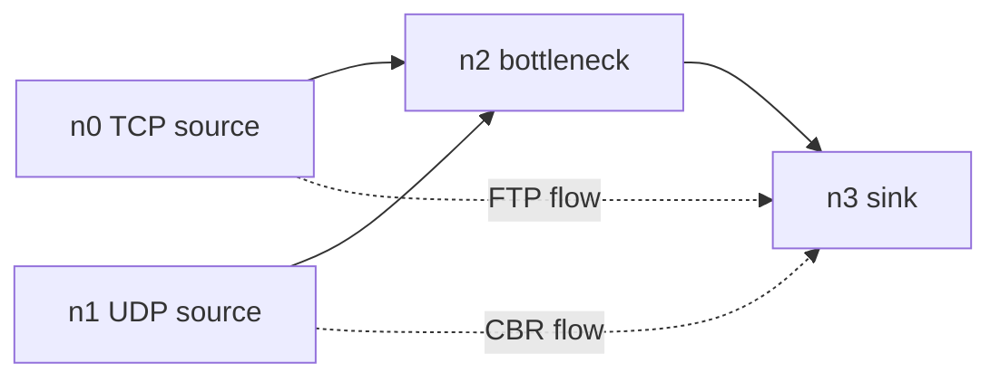

# NetworksProject

NS2 network simulation scripts with AWK trace analysis for throughput, delay, jitter and packet loss.


## Overview

This repository contains classroom NS2 simulations written in Tcl and AWK scripts that post-process NS2 trace files. The simulations cover multicast traffic, a mesh-style topology and a four-node bottleneck scenario with TCP and UDP traffic.

## Simulation scripts

| File | Topology and traffic | Output files |
| --- | --- | --- |
| `m.tcl` | Eight-node multicast scenario. Nodes `n0` and `n1` send CBR over UDP to two multicast groups using dense-mode multicast. Receivers `n5`, `n6` and `n7` join and leave groups during the run. | `output.tr`, `mcast.nam` |
| `mesh.tcl` | Sixteen-node mesh-style topology. Nodes `n0` to `n3` form a dense mesh, `n3` bridges to `n4`, `n4` fans out to several nodes and `n10` to `n15` form a ring. Three FTP flows run over TCP: `n1` to `n13`, `n9` to `n5` and `n6` to `n2`. | `out.tr`, `out.nam` |
| `unti.tcl` | Four-node bottleneck topology where `n0` and `n1` feed `n3` through `n2`. It runs FTP over TCP and CBR over a custom `mUDP` agent with sender and receiver trace names `sd` and `rd`. | `out.tr`, `out.nam`, `sd`, `rd` |
| `unti2.tcl` | Same four-node bottleneck as `unti.tcl`, but with standard UDP and Null agents for CBR traffic. | `out.tr`, `out.nam` |

## Trace analysis scripts

| File | Metric computed from trace data |
| --- | --- |
| `d.awk` | Throughput on received packets from node `3` to node `4`, using total bits divided by observed duration. |
| `endtoenddelay.awk` | End-to-end packet delay for flow `2`, using first seen time and receive time per packet id. |
| `jitters.awk` | Jitter for flow `2`, using the difference between successive packet delays and sequence numbers. |
| `packetloss.awk` | Packet loss count for flow `2`, using generated packets and dropped packets in the trace. |

## Topology sketch



The sketch reflects the shared four-node bottleneck used by `unti.tcl` and `unti2.tcl`.

## Run

Install NS2 and NAM, then run a simulation from the repository root:

```bash
ns mesh.tcl
```

Analyse the generated trace file with AWK:

```bash
awk -f d.awk out.tr
awk -f endtoenddelay.awk out.tr
awk -f jitters.awk out.tr
awk -f packetloss.awk out.tr
```

## Notes from the code

- The four-node scripts limit the queue from `n2` to `n3` to 10 packets.
- `unti.tcl` calls a `stop` event at simulation time 4.5, but no `stop` procedure is defined in the file.
- `jitters.awk` contains a delay difference expression that appears to include a stray `d` token.

## Project date and contributors

- Repository created: 2017.
- GitHub contributor data lists `rishabhjain9196`.
